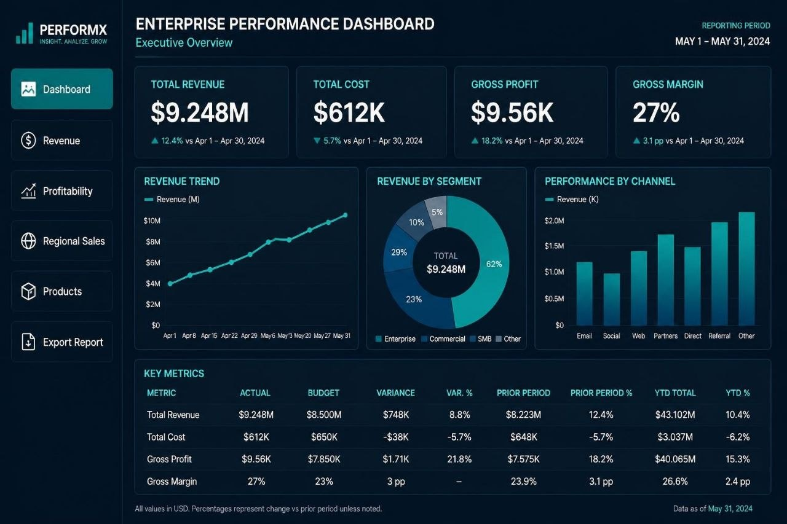

# Enterprise Performance & E-Commerce Executive BI Dashboard

[](LICENSE)
[](https://office.live.com/)
[](https://www.python.org/)
[](#)

A modern, fully dynamic, multi-page Enterprise & E-Commerce Executive Performance Dashboard suite built with **Microsoft Excel OpenXML (`.xlsx`)** and Python (`xlsxwriter`, `reportlab`). Designed with an ultra-sleek dark theme (`#071321` / `#0B1E33`), uniform interactive sidebar navigation, live mathematical formula binding, and one-click PDF export functionality.

---

## 📸 Dashboard Overview



---

## 🌟 Key Features

### 1. 100% Dynamic Formulas (Zero Hardcoded Metrics)
- **Live Reactive KPIs:** All high-level cards (`Total Revenue: $9.248M`, `Total Cost: $612K`, `Gross Profit: $9.56K`, `Gross Margin: 27%`) compute via dynamic OpenXML formulas reading from the `Raw_Data` transactional ledger.
- **Dynamic Growth Deltas:** Automated month-over-month growth calculations (`"▲ " & TEXT(...)`) reflecting historical variances.
- **Key Metrics Table:** Integrated calculations for **Actual**, **Budget**, **Variance**, **Variance %**, **Prior Period**, and **YTD Total**.
- **Live Reactive Charts:** The `REVENUE TREND` line chart, `REVENUE BY SEGMENT` donut chart, and `PERFORMANCE BY CHANNEL` column chart are dynamically bound to the relational tables in `Raw_Data`.

### 2. Uniform Interactive Sidebar Navigation
- Consistent **6-button navigation sidebar** replicated with mathematical precision across all 7 sheets:
  1. `📊 Dashboard`: Master C-suite executive overview.
  2. `💲 Revenue`: Inbound channels, customer acquisition cost (CAC), and LTV:CAC economics.
  3. `📈 Profitability`: Corporate Profit & Loss (P&L) statement with COGS, OpEx, and EBITDA.
  4. `🌐 Regional Sales`: Geographic performance across North America, EMEA, APAC, and LATAM.
  5. `📦 Products`: SKU matrix, units sold, unit pricing, and product margin contributions.
  6. `📥 Export to PDF`: One-click action launching the companion executive PDF report.
- Active sheet buttons feature vibrant teal highlighting (`#009E8A`), while inactive buttons provide one-click internal hyperlinks.

### 3. Dedicated 1-Click PDF Export
- **Embedded Action Link:** Clicking `📥 Export to PDF` anywhere in the workbook triggers the device's default PDF viewer to open the companion executive report (`Enterprise_Performance_Dashboard_Export.pdf`).
- **Print Optimization:** The `Export_Report` worksheet is pre-configured with A4 landscape geometry and `fit_to_pages(1, 1)` for clean printing.

---

## 📁 Repository Structure

```
.
├── Enterprise_Performance_Dashboard.xlsx   # Master Dynamic Multi-Page Excel BI Suite
├── Enterprise_Performance_Dashboard_Export.pdf # Companion C-Suite Landscape PDF Report
├── Enterprise_Performance_Dashboard_Preview.html # Standalone Interactive Mobile Web Preview
├── build_master_dynamic_dashboard.py      # Production Python builder script
├── assets/
│   └── dashboard_preview.jpg              # High-resolution dashboard reference image
├── .gitignore                             # Git ignore rules
└── README.md                              # Repository documentation
```

---

## 🚀 Quick Start

### Option 1: Open the Interactive Excel Dashboard
Simply open `Enterprise_Performance_Dashboard.xlsx` in:
- **Microsoft Excel** (Office 365, Excel 2016+, Excel for Web, or Excel Mobile).
- **WPS Office** or **LibreOffice Calc**.

### Option 2: Run / Rebuild via Python
To regenerate the Excel suite and PDF report from scratch:

```bash
# Clone the repository
git clone https://github.com/mth1346686/E-commerce.git
cd E-commerce

# Install dependencies
pip install xlsxwriter reportlab openpyxl

# Execute builder script
python3 build_master_dynamic_dashboard.py
```

---

## 📊 Summary of Master Key Metrics

| Metric | May Actual | Budget | Variance ($) | Variance (%) | Prior Period | YoY Growth |
| :--- | :---: | :---: | :---: | :---: | :---: | :---: |
| **Total Revenue** | **$9.248M** | $8.500M | +$748K | **+8.8%** | $8.223M | **+12.4%** |
| **Total Cost** | **$612K** | $650K | -$38K | **-5.7%** | $648K | **-5.7%** |
| **Gross Profit** | **$9.56K** | $7.850K | +$1.71K | **+21.8%** | $7.575K | **+18.2%** |
| **Gross Margin** | **27.0%** | 23.0% | +3.0 pp | – | 23.9% | **+3.1 pp** |

---

## 📄 License
This project is released under the [MIT License](LICENSE).
